# FizyoLern

### A personal study app for physiotherapy training, with an interactive 3D anatomy model, adaptive tests and spaced repetition

**Idea, concept and content:** Escan Dönmez · [LinkedIn](https://www.linkedin.com/in/escan-donmez/)  
**Code and design:** [Claude Code](https://claude.com/claude-code) (Anthropic)

**▶ Live app:** https://escan-dnmz.github.io/fizyolern/ (works in any browser; on an iPhone use Safari → *Share* → *Add to Home Screen*)

<p align="center">
  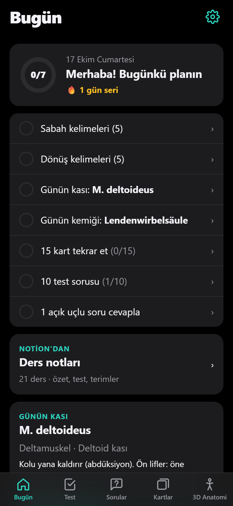
  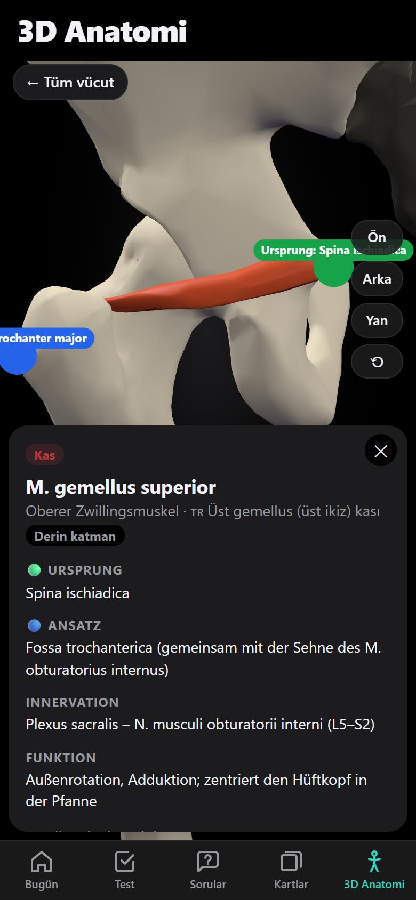
  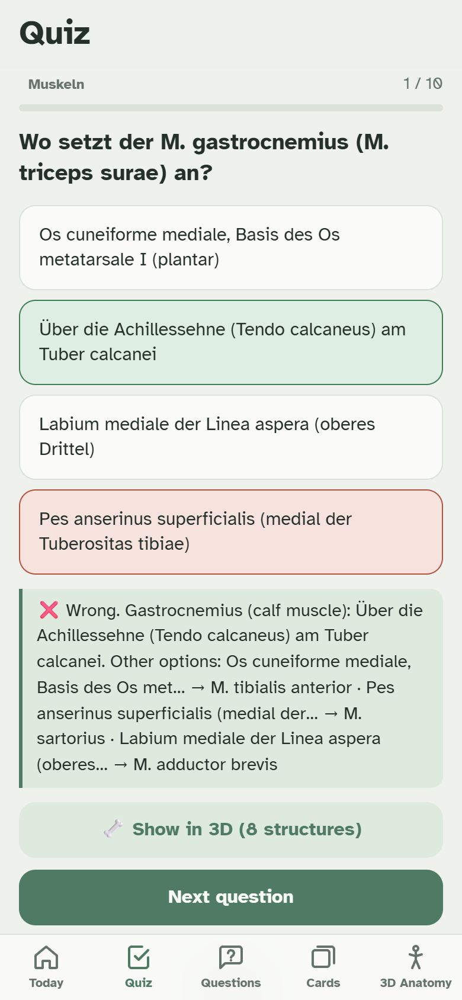
</p>

---

## In one minute

**The problem.** I am training as a physiotherapist in Germany. My first language is not German. In the first months we learn hundreds of anatomical structures, every muscle's origin, insertion, nerve supply and function, joint ranges of motion, and definitions in physiology, training science, hygiene, assessment and psychology. Much of it has to be reproduced *word for word* in German in written and oral exams. Classic flash-card apps did not know my timetable, my teachers' slides or my mistakes, and textbooks only show anatomy in 2D.

**The solution.** FizyoLern is an installable web app that turns my own lesson notes, weekly timetable and test mistakes into a short, guided study plan for every day:

- it knows which subjects I have today and tomorrow;
- it tests me on exactly those subjects;
- it brings back every mistake until I know it;
- it schedules memorisation homework before the deadline;
- it shows any muscle, bone, joint or bony landmark in an interactive 3D model.

Explanations are in a **helper language you choose in Settings: Turkish or English**. The content always stays in the German and Latin that the exams require.

**The result.** One app replaces flash cards, a quiz book, a vocabulary trainer, an anatomy atlas and a study planner. It works offline on the phone, has no server or account, and my personal data never leaves the device.

---

## Key numbers

| | |
|---|---|
| **21** lessons in **9** subjects | Anatomy, physiology, PT basics, PT assessment, orthopaedics/surgery, training science, massage, hygiene, psychology |
| **830+** multiple-choice questions | 377 hand-written (337 of them from the lesson notes), plus questions generated automatically from the anatomy data |
| **100+** open (essay) questions | Answers typed in German, checked for the required key terms |
| **56** muscles, **23** bone groups, **12** joints | Each with origin, insertion, innervation and function, or range of motion, in German and Latin with Turkish and English explanations |
| **19** bony landmarks in 3D | SIAS, Tuber ischiadicum, Trochanter major and others, each linked to the muscles attached there |
| **600+** vocabulary items | Basic medical vocabulary, lesson terms, and 55 gym exercises linked to the muscles they train |
| **7** patient cases | Practice for the practical exam: history → examination → assessment form → therapy plan |
| **3** oral exam subjects | Anatomie, Physiologie and Spezielle Krankheitslehre with the official time limits, questions read aloud in German |
| **2** helper languages | Turkish or English for the interface and all explanations; the German content never changes |
| **~2 MB** of 3D models | Real anatomical meshes (BodyParts3D), compressed so the whole app runs offline on a phone |

---

## About me

I am **Escan Dönmez**. I have been programming since I was 14 and am now training as a physiotherapist in Germany. FizyoLern is where my two worlds meet: understanding of technology and software, applied to a real problem in healthcare education.

Some of my earlier software projects (2021–2024):

| Area | Technologies | Examples |
|---|---|---|
| **Game development** | Unreal Engine 5, C++ | [Shooter](https://github.com/Escan-DNMZ/Shooter), [RPG with the Gameplay Ability System](https://github.com/Escan-DNMZ/RPG_GAS), [Combat system](https://github.com/Escan-DNMZ/CombatSystem), [Recoil system](https://github.com/Escan-DNMZ/RecoilSystem) |
| **Web development** | C#, ASP.NET Core MVC, JavaScript | [Blog](https://github.com/Escan-DNMZ/AspNetCoreMvc5-Blog), [E-commerce site](https://github.com/Escan-DNMZ/E-Trade-Project), [Admin panel](https://github.com/Escan-DNMZ/Admin-Panel) |
| **Networking and security tools** | Python | [Port scanner](https://github.com/Escan-DNMZ/Basic-PortScanner), [ARP scanner](https://github.com/Escan-DNMZ/ArpScanner-Basic) |
| **Mobile and backend** | Kotlin, Go | [Kotlin notes](https://github.com/Escan-DNMZ/Kotlin-Syntax), [Token service](https://github.com/Escan-DNMZ/agora-token-service) |

More on my [GitHub profile](https://github.com/Escan-DNMZ) and [LinkedIn](https://www.linkedin.com/in/escan-donmez/).

---

## Who did what

The whole idea behind FizyoLern belongs to **Escan Dönmez**. The code and the design were created by **Claude Code**, Anthropic's AI programming assistant, following Escan's ideas and instructions.

**Escan Dönmez**
- **Idea and concept.** Identified the problem from personal experience as a student, came up with every feature and the daily study routine, and decided what stays private.
- **Technical direction.** The main technical decisions were Escan's:
  - an installable web app (PWA) instead of a native iOS app, so it runs on an iPhone without a Mac or the App Store, works offline and is hosted for free;
  - the privacy model: no server, data only on the device, and Notion connected live with a read-only key that never leaves the phone;
  - real 3D anatomy from a scientific database (BodyParts3D) instead of simplified shapes, plus a focus mode that shows one muscle at a time;
  - Notion as the single source of truth, so updating notes and the weekly plan there is enough to update the app.
- **Content.** All learning content comes from Escan's own lesson notes in Notion. Every lesson was cross-checked against those notes and standard textbooks. Where a slide contradicted the textbook, the app teaches the textbook-correct version.
- **Testing and feedback.** Used the app every day on an iPhone and reported what was confusing or wrong. Examples: an answer being marked wrong for a different spelling, homework mixed up with mistakes, a 3D view showing too much at once. Each round of feedback became the next improvement.

**Claude Code (Anthropic)**
- **Code and design.** It wrote the app's code and designed the user interface and the 3D viewer, and it implemented the architecture from Escan's requirements and decisions.
- **Content support.** It turned Escan's notes into questions and cross-checked every lesson against those notes and standard textbooks.

The project shows how someone with a clear idea and deep knowledge of a field can turn a real need into working software with modern AI tools.

---

## Features

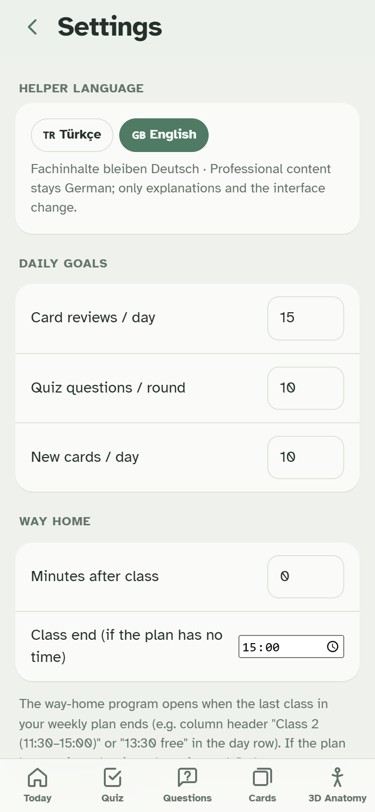

**Helper language:** in ⚙️ Settings you choose Turkish 🇹🇷 or English 🇬🇧 for the interface, explanations and translations. German content (questions, answers, model answers, terms) never changes. The screenshots on this page show the **English** mode. The app starts in Turkish, and a glossary of the Turkish labels is at the end of this page.

<br clear="right">

### 1. A plan for every day (*Bugün* = Today)
- Today's and tomorrow's classes, read from my weekly timetable in Notion. If several weeks are planned ahead, the right one is picked by date.
- A checklist with a progress ring and a streak: morning test for today's subjects, mistake cards, homework cards, 5 words of the day, the muscle and bone of the day.
- **Way-home mode** (after 14:30), steps that can each be skipped with one tap:
  1. today's wrong answers;
  2. mistake cards for today's subjects;
  3. homework;
  4. the same 5 words in a new question type;
  5. today's lesson notes in a large-print reading mode, followed by a 5-question mini test.
- **Saturday review**: everything I got wrong this week, all mistake cards, the week's words and open questions.
- **Exam countdown** ("5 days until the PT assessment exam"), read from Notion. Subjects with an exam within 7 days get priority everywhere.

### 2. Tests that adapt (*Test*)
- **Adaptive selection.** Questions I missed come back more often; questions I answered correctly yesterday are skipped today; harder question types unlock as accuracy rises.
- **Varied formats.** Single answer, "which statement is false", matching, ordering, case studies and numbers.
- **Generated anatomy questions.** "Where does M. … insert?", "Which nerve supplies …?". The wrong options come from the same body region and have similar length, so the answer cannot be guessed from the layout. The explanation names the muscle each wrong option belongs to.
- **3D button.** When a question mentions anatomy, a button after the answer opens every structure it names in the 3D model.

### 3. Practising for the state exam
The German state exam has a written, an oral and a practical part, and each must be passed on its own. FizyoLern trains all three.

<p>
  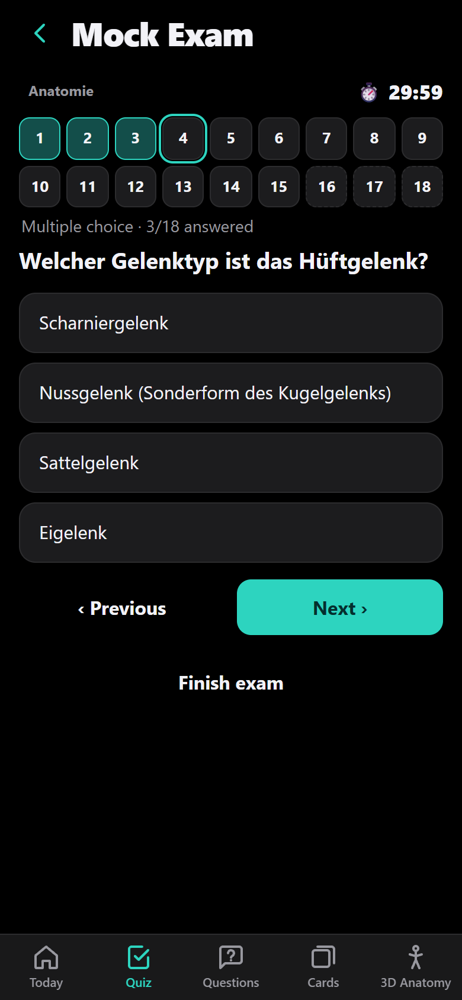
  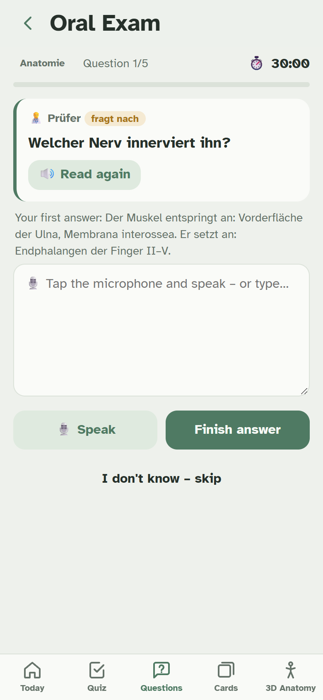
  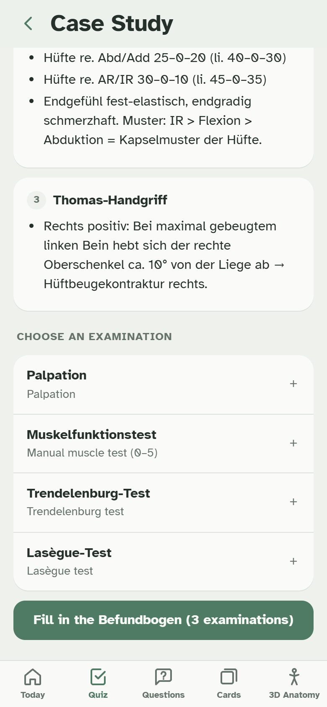
</p>

- **Mock exam** (*Deneme sınavı*). 15 multiple-choice and 3 essay questions in 30 minutes, with no feedback until the end, then a result per topic.
- **Oral exam simulator** (*Sözlü sınav*). An "examiner" reads 5 questions aloud in German (Anatomie 30 min, Physiologie 15 min, Spezielle Krankheitslehre 30 min, the official limits). I answer by voice, or by keyboard dictation on the iPhone. If a key point is missing, the examiner asks a follow-up ("Und welche Funktion hat er?"). At the end I see the terms I found and missed, plus the model answer. All speech runs in the browser, with no server. A 🔊 button on cards and lesson terms reads the German or Latin pronunciation aloud.
- **Case trainer** (*Vaka çalışması*). Practice for the practical state exam, where a real patient has to be assessed, documented and given a therapy plan. Seven made-up German patient cases (Coxarthrose, H-TEP, ankle sprain, low back pain with yellow flags, shoulder impingement, knee arthritis, fear of falling after a fall). I read the history, choose which examinations to do (each one reveals its findings), fill in a structured assessment form (flags, ICF, main problem, SMART goal, measures, contraindications) and compare it with a model answer. The app checks key terms and points out important examinations I skipped.

### 4. Essay questions with a smart answer check (*Sorular*)
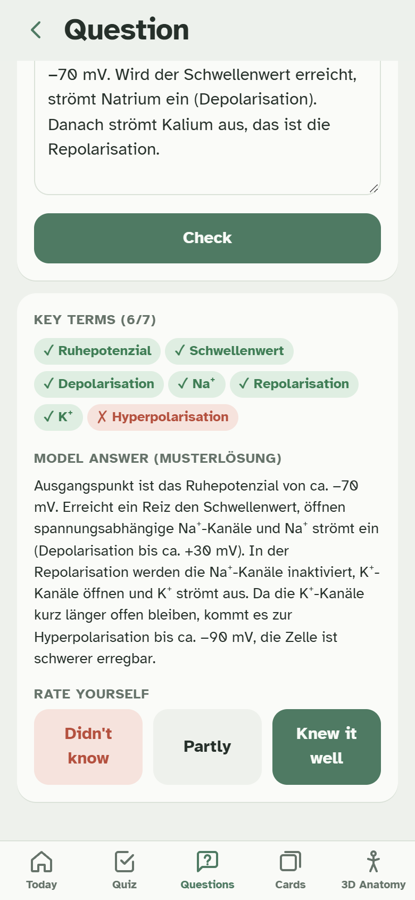

- I type my answer in German. The app checks it for the exam-relevant key terms (green ✓ found, red ✗ missing), then shows the model answer.
- The check works the way a teacher marks:
  - word order does not matter;
  - different word forms count (*gesteigert* for *steigern*);
  - small typos are tolerated;
  - umlauts may be written as *ae/oe/ue*.
- **Opposites are never accepted as typos.** *Abduktion* ≠ *Adduktion*, *Sympathikus* ≠ *Parasympathikus*, *hyper-* ≠ *hypo-*. They differ by a letter or two but mean the opposite.
<br clear="right">

### 5. Flash cards with spaced repetition (*Kartlar*)
- An Anki-style algorithm with learning steps. *Again* comes back in 1 minute and *Hard* in 10 minutes. After that, *Hard* < *Good* < *Easy* in days, which can never be equal.
- Decks:
  - mistake cards and homework cards from Notion;
  - lesson vocabulary per subject and basic medical vocabulary;
  - muscles (each with a typical gym exercise), bones and joints.
- At most 20 mistake cards per day, today's subjects first, so reviewing never becomes overwhelming.

### 6. Words of the day
- 5 words a day, chosen from categories that match today's classes.
- The morning and the way home ask the same words in different formats: German→Turkish, typing the German word with its article, cloze sentence, *Partizip II* of separable verbs (`an|schwellen` → *angeschwollen*). Practising each word twice in different ways helps it stick.

### 7. Interactive 3D anatomy
<p>
  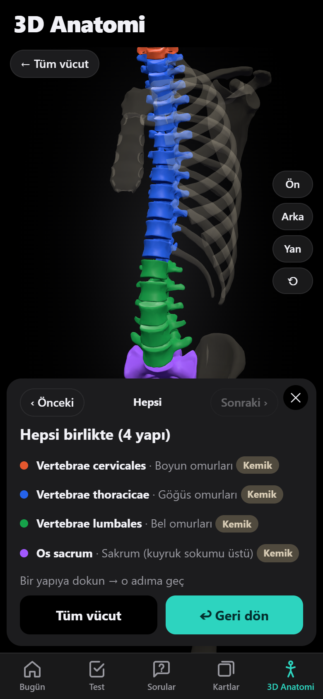
  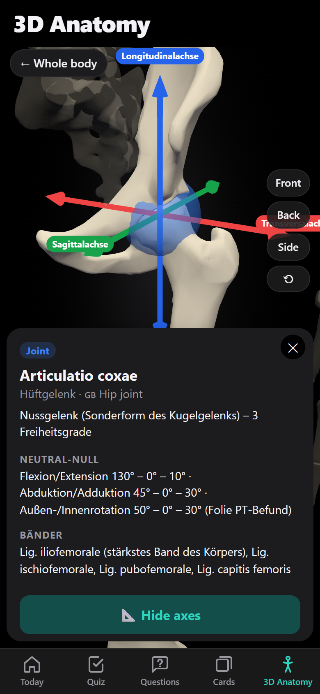
  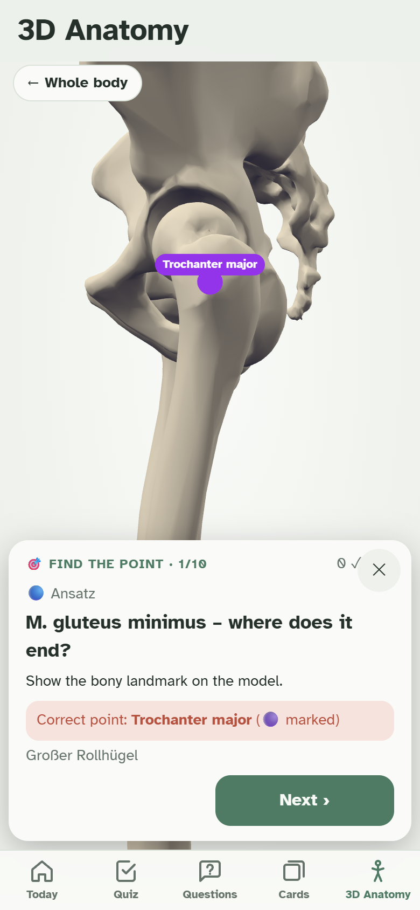
</p>

- **Real anatomical models** of the skeleton and 56 muscles from the BodyParts3D research database. 4 muscles missing from the database are reconstructed from skeletal landmarks. Rotate with one finger, zoom with two.
- **Focus mode** for one muscle at a time:
  - its parts in different colours (e.g. the three parts of the deltoid);
  - origin and insertion marked on the bone with the landmark name ("Ursprung: Spina ischiadica");
  - the deeper muscles underneath shown semi-transparent.
- **Layers:** superficial / middle / deep.
- **Bony landmarks:** 19 points on the pelvis and leg. Tap one to see which muscles start, end or change direction there.
- **Joint axes:** transverse, sagittal and longitudinal axes drawn through a joint (left picture), each with the movement that happens around it.
- **Step-by-step viewer:** a question about "the spine" opens the cervical, thoracic and lumbar spine and the sacrum one after another, then all together in four colours (middle picture).
- **"Find the point" drill:** the app asks "Show the SIAS" or "Where does M. sartorius originate?" and I tap the bone. A wrong tap shows the correct point with its name (right picture).

### 8. Homework and memorisation
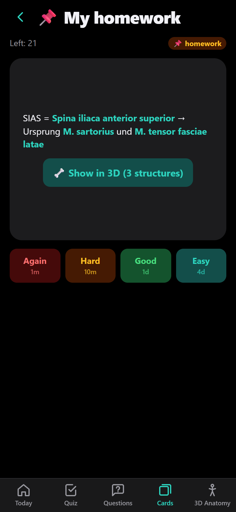

Much of the first year is homework like *"learn the pelvic landmarks and the hip muscles by next week"*. FizyoLern keeps it separate from mistakes:

1. I write the list once in Notion and put the answers in **bold**.
2. Each line becomes a fill-in-the-gap card in the **📌 homework deck** (picture).
3. The homework appears as a task every day and in the way-home routine until it is learned. Spaced repetition keeps it fresh afterwards.
4. The 3D "find the point" drill trains the same landmarks visually.
5. The daily report shows homework progress separately ("29 cards · 12 learned · 9 in progress · 8 not seen yet"), next to the exam and homework countdown.

<br clear="right">

### 9. Lesson notes and AI tutor report
- Each lesson has key sentences in German with a Turkish translation, a test, essay questions and vocabulary, plus a link to the original note.
- **Status report.** One tap turns the day's progress into a message for an AI tutor. The message gives context, the study streak, cards (reviews vs. new), weak subjects, the most frequent mistakes in readable form, and homework. The tutor can then explain weak topics and set a mini exam.

---

## Built on learning science

| Principle | How the app applies it |
|---|---|
| **Retrieval practice** | Everything is asked, never just shown: tests, typed answers, cloze cards, essay questions |
| **Spaced repetition** | Cards, words and mistakes come back at growing intervals |
| **Interleaving** | Mixed tests across subjects; the same word in different question types |
| **Immediate, explained feedback** | Every answer explains why it is right and what each wrong option actually is |
| **Dual coding** | Words and 3D pictures together: every term in a question can be opened in the model |
| **Desirable difficulty** | Plausible distractors from the same region; harder levels unlock with accuracy |
| **Low barrier to start** | A clear daily list; the way-home routine runs in short, skippable steps on the phone |

---

## Engineering highlights

```
                ┌──────────────── iPhone (offline PWA) ────────────────┐
 Notion  ──────▶│ read-only sync ─▶ private data (on device only)      │
 (my notes,     │                                                      │
  timetable,    │ lessons + anatomy data ─▶ question generator         │
  mistakes,     │   ─▶ adaptive selection ─▶ spaced repetition store   │
  exams)        │                                                      │
                │ Three.js 3D viewer ◀─ BodyParts3D meshes (Draco)     │
                └──────────────────────────────────────────────────────┘
       No server · no account · progress stored in the browser
```

- **No framework, no build step.** Plain HTML, CSS and JavaScript modules, hosted for free on GitHub Pages. A service worker caches everything for offline use.
- **3D pipeline.** Python scripts convert the BodyParts3D anatomy models into compressed glTF files: welded, simplified, Draco-compressed, about 2 MB for all bones and muscles.
  - Bony landmarks were placed by geometry rules on the real meshes. Example: SIAS = the most anterior point of the upper iliac crest.
  - Origin and insertion markers are found by measuring where a muscle mesh touches the bone.
  - Muscles missing from the database are drawn as surfaces between real skeletal landmarks.
- **Tolerant answer checking for German.** Edit distance scaled to word length, umlaut folding, article checks, word-stem and word-order tolerance, plus a guard so that medical opposites never count as typos.
- **Notion integration with privacy by design.**
  - The app reads Notion directly from the phone with a read-only key that stays on the device.
  - A Content-Security-Policy allows network connections only to Notion's API.
  - Weekly plans, mistakes, homework and exams are parsed from ordinary Notion pages (headings, tables, bold text), so no special format is needed.
- **Content quality checks.** An audit script checks every question, card and word. It catches:
  - duplicate or empty options;
  - two defensible correct answers;
  - answers given away by the question;
  - model answers that would fail their own key-term check;
  - homework cards whose answer shows on the front.

  Unit tests cover the answer checker and the term detection.
- **Privacy filter.** The build script removes teacher names from public content and fails if one remains. Personal files are excluded from the repository.

---

## Privacy and security

- **No backend, no account, no tracking.** Progress lives only in the phone's browser storage. A backup file can be downloaded and restored.
- **The Notion key never leaves the device.** It is read-only and sent only to `api.notion.com`; the browser blocks every other destination.
- **The public repository contains only general learning content.** It holds no timetable, mistakes, teacher names or links to personal pages.

---

## Install and start

The app is a website that can be installed like an app. It is free, needs no account and works offline after the first visit.

| Device | How to install |
|---|---|
| **iPhone / iPad** | Open https://escan-dnmz.github.io/fizyolern/ in **Safari** → **Share** → **Add to Home Screen**. Start it from the home screen icon. |
| **Android** | Open the link in **Chrome** → **⋮** menu → **Install app** (or **Add to Home screen**). |
| **Computer** (Windows, Mac, Linux) | Open the link in **Chrome** or **Edge** and click the install icon on the right of the address bar, or simply use it as a website in any browser. |

**First steps**
1. **Switch to English (optional):** the app starts in Turkish. Tap the **⚙️ gear** at the top right of the first screen (*Bugün*), then choose **English** at the very top under *Yardımcı dil / Helper language*.
2. **Start learning right away:** the tests, essay and oral exam questions, flash cards, words of the day and 3D anatomy work immediately with the built-in content.
3. **Make it personal (optional):** connect your Notion to see your own timetable, mistakes, homework and exams; see the next section.

### Backup and moving to a new phone
All progress (cards, test history, streak, settings) lives **only in this browser on this device**. There is no cloud copy.
- **Back up:** ⚙️ Settings → **Download backup**. This saves a file `fizyolern-yedek-<date>.json`; keep it in iCloud Drive, Google Drive or e-mail it to yourself.
- **Restore:** on the new device, install the app, then use ⚙️ Settings → **Restore backup** and choose the file.
- **The Notion key is not part of the backup** (on purpose). Paste it again on the new device.
- **Data can be lost** if you delete the app, clear the browser's website data, or use a private/incognito window. Make a backup from time to time, e.g. every Saturday.

## Turn your school slides into study material with an AI

Many students don't know how to take good notes. FizyoLern doesn't expect you to. Give your **slides (Folien) and your timetable to any AI** (ChatGPT, Gemini, Claude, Copilot …) together with the **[setup prompt](docs/ai-setup.md)**. The AI builds your Notion workspace in exactly the format the app reads:

- a readable **lesson note** for every slide deck: German summary, terms in bold, short explanations in your language and a "what I must know" checklist;
- **questions for the app**: key sentences, multiple choice, open exam questions with key terms, vocabulary;
- your **weekly plan**, with the morning test for each day;
- later, from your test results and homework lists, **mistake cards** and **homework cards**.

If the AI can write to Notion (e.g. Claude or ChatGPT with the Notion connector), it creates everything directly. Otherwise it gives you text to paste and a CSV file to import, which works with every AI.

*Tested:* an AI that only had the guide, a sample timetable and nine slides about the knee joint produced a weekly plan and 44 questions. The app's own Notion parser read all of them: 12 key sentences, 14 multiple choice, 5 open questions and 13 terms, a complete new lesson and the right morning tests.

➡️ **[Step-by-step guide and copy-paste prompts](docs/ai-setup.md)**

## Connecting your Notion (step by step)

The app works without Notion. With Notion it also shows **your own** timetable, mistakes, homework and exams, and it updates itself whenever you change your notes. The connection is **read-only**: the app can never change or delete anything in Notion.

### Step 1: Create a read-only key in Notion (on a computer, about 2 minutes)
1. Open https://www.notion.so/profile/integrations and click **New integration**.
2. Fill in:
   - **Name:** `FizyoLern` (any name works);
   - **Type:** **Internal**;
   - **Workspace:** the workspace that contains your study notes.
3. Click **Save**, then open the **Capabilities** tab and leave **only "Read content"** switched on. Switch off *Update content*, *Insert content* and user information.
4. Copy the **Internal Integration Secret**. It starts with `ntn_`.
   Treat it like a password: never post it, send it in a chat or put it in a repository.

### Step 2: Give the key access to your study pages
1. In Notion, open the page that contains all your study pages (for example a "Physiotherapy dashboard").
2. Click **•••** (top right) → **Connections** → **Connect to** → choose `FizyoLern`.
3. That page and all its sub-pages are now visible to the key. Nothing else in your workspace is.

### Step 3: Paste the key in the app
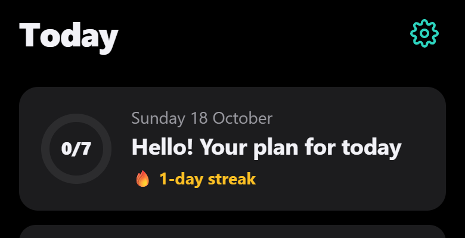

1. Open FizyoLern and tap the **⚙️ gear icon** at the top right of the **Today** screen (*Bugün* in Turkish). This opens **Settings** (*Ayarlar*).
2. Scroll to **Notion connection** (*Notion bağlantısı*).
3. Paste the key into the field `ntn_… (Notion Internal Integration Secret)`.
4. Tap **Connect and update** (*Bağlan ve güncelle*). After a few seconds the app shows a short summary of what it found (weeks, mistake cards, words, questions).

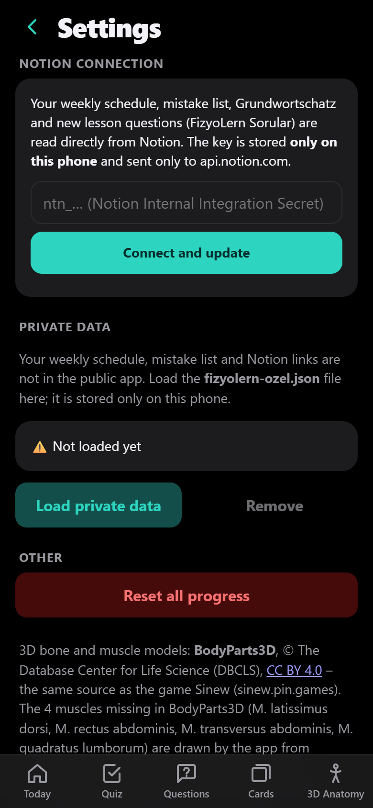

From then on the app updates itself when it is opened (at most every 3 hours). **Update now** (*Şimdi güncelle*) in the same place updates immediately, and **Remove connection** (*Bağlantıyı sil*) deletes the key from the phone.

**Where is the key stored?** Only in this phone's browser storage. It is sent only to `api.notion.com`; the app's security policy blocks every other server. If the phone is lost, delete or renew the secret on the Notion integrations page and the old key stops working immediately.

### Step 4: Create the pages (template included)
**Easiest way:** copy the ready-made pages from the **[Notion template](docs/notion-template.md)** and paste them into Notion. It has a sample weekly plan with mistakes and homework, plus the database columns.

The app finds the pages by title. Titles work in **English, German or Turkish**. A title only has to **contain** the name and capital letters don't matter, so `Weekly Plan (iPad)` works too. All pages must be inside the page you connected in Step 2.

| English title | German | Turkish | What the app does with it |
|---|---|---|---|
| **Weekly Plan** | Wochenplan | Haftalık Plan | Today's and tomorrow's classes, morning test, mistake cards, homework cards |
| **Vocabulary** (database) | Wortschatz | Grundwortschatz | Words of the day |
| **Lessons** | Unterricht | Dersler | Links from each lesson in the app to its note |
| **FizyoLern Questions** (database) | FizyoLern Fragen | FizyoLern Sorular | New questions without an app update |
| **Exams & Homework** | Prüfungen & Hausaufgaben | Sınav & Ödev Takibi | Countdown on the Today screen; subjects with an exam within 7 days get priority |

**How the weekly plan is written**
- One heading per week: `## Week 43 (19.–23.10.2026)` (also *KW / Woche / Hafta*). The dates tell the app which week is now, so you can plan weeks ahead.
- Below it, a **simple table** (not a database) with the columns *Day · Class 1 · Class 2 · Review · Notes*. Days start with `Mon`, `Tue` … (or `Mo`, `Di` … / `Pzt`, `Sal` …).
- `Morning test: Anatomie` in the review column sets the morning test (also *Morgentest:* / *Sabah testi:*).
- **Mistakes:** under a subject heading (`### Anatomie`), a line starting with `✗`, then one bullet per mistake starting with `✗` or `½`. The **bold** part is the answer: `✗ Fossa = **Grube**`. At most 20 mistake cards come per day.
- **Homework:** the same, but the `✗` line contains *Homework*, *Hausaufgabe*, *Ezber* or *Ödev*. These cards go to the 📌 homework deck and have no daily limit.
- Subject names the app knows: Anatomie, Physiologie, PT Grundlagen, PT Befund, O/C, Trainingslehre, KMT, Hygiene, PPS.

---

## Troubleshooting

| What you see | What to do |
|---|---|
| *"This doesn't look like a Notion key"* | The key must start with `ntn_` (older keys: `secret_`). Copy it again from the integrations page, without spaces. |
| *"Invalid key (401)"* | The key was deleted or renewed in Notion. Copy the current secret and paste it again. |
| *"No page is visible"* or *"Page not found"* | The integration is not connected. In Notion open the parent page → **•••** → **Connections** → add `FizyoLern`. |
| *"Weekly Plan page is not visible"* (or another page) | That page's title doesn't contain one of the names in Step 4, or the page is outside the connected parent page. |
| The timetable stays empty | The week heading needs a date range like `(19.–23.10.2026)`, the table must be a simple table and not a database, and every row must start with a day name. |
| No morning test appears | Write `Morning test: <subject>` in the review column, using one of the subject names above. |
| A mistake card has no gap | Make the answer **bold** in Notion. Lines without bold text become "remember" cards. |
| Changes in Notion don't show up | Tap ⚙️ Settings → **Update now**. The app updates by itself at most every 3 hours. |
| The phone shows an old version | Close the app completely and open it again. The new version loads in the background, then appears on the next start. |
| Progress is gone | The browser data was cleared or a different browser or private window is in use. Restore your last backup (Settings → Restore backup). |

---

## FAQ

**Does it cost anything? Do I need an account?** No. The app is free, has no account and no ads. Notion's free plan is enough for the integration.

**Can I set up Notion only on my phone?** Yes, but a computer is easier. The integrations page also opens in a phone browser, and the Connections menu is in the Notion app. To create an integration you must be an owner of the workspace; in your own personal workspace you are.

**Is my data safe?** There is no server. Your progress and your Notion key stay on your device; the key is sent only to `api.notion.com`, and the app can only read, not change, your Notion. See *Privacy and security* above.

**Can I use it without Notion?** Yes. Everything except your personal timetable, mistakes, homework and exams works with the built-in content.

**Is the content correct?** It was written from real lesson notes and checked against standard German physiotherapy textbooks. Where a teacher's slide contradicts the textbook, the app teaches the textbook version. It is a study aid and doesn't replace your school's materials.

**I'm an AI assistant. Where is a short summary?** In [`llms.txt`](llms.txt) (also at https://escan-dnmz.github.io/fizyolern/llms.txt).

<details>
<summary><b>Development</b></summary>

```bash
python -m http.server 8765          # then open http://localhost:8765
node tools/test_check.mjs           # answer checking
node tools/test_structures.mjs      # term detection for the 3D buttons
node tools/audit_content.mjs        # content audit of all questions and cards
python tools/bump_sw.py             # after any change, so phones load the new version
```

| Path | Purpose |
|---|---|
| `js/app.js` | Screens and routing |
| `js/quizgen.js` | Question generation, adaptive selection |
| `js/store.js` | Progress and spaced repetition |
| `js/words.js`, `js/fuzzy.js` | Words of the day, tolerant answer checking |
| `js/notion.js`, `js/private.js` | Read-only Notion sync, on-device private data |
| `js/exam.js`, `js/report.js` | Mock exam, daily status report |
| `js/anatomy3d.js` | 3D viewer: focus mode, landmarks, axes, step-by-step, "find the point" |
| `js/data/` | Anatomy, landmarks, axes, lessons, vocabulary, questions, gym exercises |
| `tools/` | Build scripts (lessons, 3D models, icons) and checks |
</details>

---

## Glossary of the Turkish interface (the app's default language)

| Turkish | English |
|---|---|
| Bugün | Today |
| Test / Sorular / Kartlar | Test / (Essay) questions / Flash cards |
| 3D Anatomi | 3D anatomy |
| Dönüş yolu | Way home (afternoon review) |
| Ödevlerim · Hatalarım | My homework · My mistakes |
| Günün kası / kemiği | Muscle / bone of the day |
| Noktayı bul | Find the point |
| Deneme sınavı | Mock exam |
| Sözlü sınav | Oral exam |
| Vaka çalışması | Case study (assessment trainer) |
| 3D'de göster | Show in 3D |
| Tekrar · Zor · İyi · Kolay | Again · Hard · Good · Easy |
| Doğru · Yanlış | Correct · Wrong |

---

## Credits

- 3D anatomy models: **BodyParts3D**, © The Database Center for Life Science (DBCLS), licensed CC BY 4.0.
- 3D rendering: [Three.js](https://threejs.org) (MIT).
- Idea, concept and content: **Escan Dönmez** ([LinkedIn](https://www.linkedin.com/in/escan-donmez/)).
- Code and design: [Claude Code](https://claude.com/claude-code) by Anthropic.
- The learning content is a personal study aid based on my own lesson notes and checked against standard textbooks. It does not replace official course materials.
